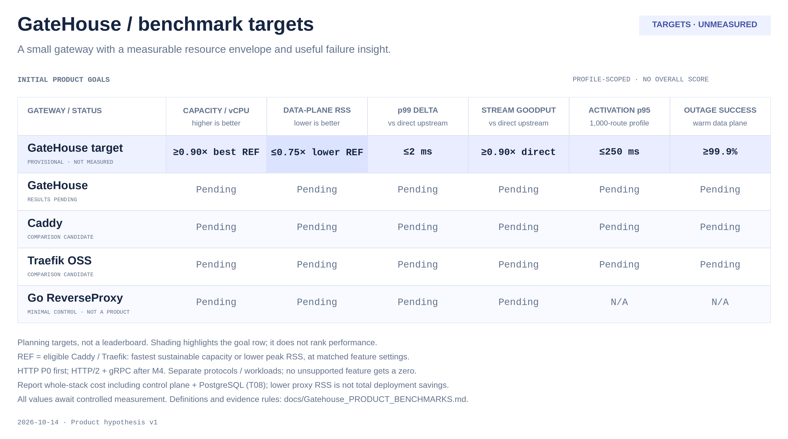
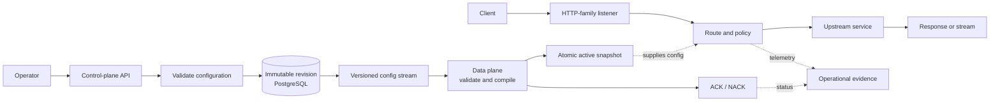

<div align="center">

# GateHouse

### Change routing while requests keep running.

A Layer 7 gateway in Go for small HTTP/gRPC service deployments, built toward safe dynamic configuration, predictable resource use, and useful traffic and failure insight.

**Go:** 1.26.9 · **Contracts:** Protobuf · **CI:** [GitHub Actions](https://github.com/SShogun/GateHouse/actions/workflows/ci.yml)

</div>

> **Project state: M2 data plane plus M3 Parts 1–3 implemented; local verification passed and exact-head hosted CI is green on `67c46cb`.** M3 has typed configuration/Admin protobufs, PostgreSQL revision storage, a loopback-only development control plane, config streaming, instance status, and opt-in dynamic data-plane activation with last-known-good snapshots. Part 3 adds database integration and recovery tests, an executable restart scenario, and bounded 1,000-revision churn coverage. Local PostgreSQL verification used a disposable PostgreSQL 18.6 instance; CI runs the suite against PostgreSQL 16.

[What exists](#what-works-today) · [Try M3](docs/Gatehouse_M3_DEMO.md) · [Run checks](#try-the-current-foundation) · [Milestone showcases](#milestone-showcases) · [Docs](#repository-map)

**The current showcase:** publish a configuration that routes to blue, change it to green without restarting the gateway, reject an invalid update, roll back, and stop the control plane while traffic continues. Revision history and instance status make each result inspectable. Follow the [M3 walkthrough](docs/Gatehouse_M3_DEMO.md) from a clean checkout; it uses repository-owned example configurations rather than temporary agent tools.

**Interface today:** backend processes, a typed gRPC Admin API, and JSON readiness/status endpoints. The graphical operator console is planned for M7. There is no shipped one-command deployment launcher or production authentication yet.

---

## The idea

Gateways are easy to describe as boxes and hard to get right at the edges. A client disconnect must stop upstream work. A config update must not expose a half-built state. A streamed response must remain streamed. Retries must not turn an outage into a traffic multiplier.

GateHouse is being engineered in small, reviewable increments, with executable tests for the guarantees that matter under real traffic instead of relying on architecture diagrams alone.

The intended users are developers and small platform teams running roughly 5–20 services on VMs or Docker Compose. GateHouse is being built as an independently deployed gateway they can use in their own projects. Its intended advantage is a measured resource envelope plus revision-aware failure insight: what configuration is active, why a change was rejected, and whether management failure affected traffic.

The architecture goals are:

- Keep PostgreSQL and configuration-management calls out of the normal request path.
- Activate complete validated snapshots; preserve the configuration held by existing requests.
- Bound request concurrency, buffering, background work, retries and telemetry cardinality.
- Preserve real HTTP/2, gRPC and Connect semantics as those capabilities are implemented.
- Provide authenticated administration, secure control channels, diagnostics and a reproducible deployment before a production release.
- Select maintained dependencies for product outcomes, rather than restrict them for learning value alone.

The initial performance hypothesis is 25% lower data-plane memory than eligible reference gateways while retaining at least 90% of the fastest reference's capacity. Whole-deployment reporting must include the control plane and PostgreSQL. **These are targets, not measured results; GateHouse is not yet a production release.** Protocol, security, full-stack footprint and beta gates remain in the plan.



The [product and benchmark contract](docs/Gatehouse_PRODUCT_BENCHMARKS.md) defines all units, workloads and comparison rules. Competitor cells remain pending until measured together. **Benchmark execution is deferred by [D052](docs/Gatehouse_DECISIONS.md#d052--defer-benchmark-execution-and-resume-protocol-implementation); M4 functional work may proceed first.** Measurement and release requirements remain open. M8 owns extended fault/soak and performance regression.

Its eventual boundary is deliberately split:

- **Control plane:** validates configuration, stores immutable revisions, publishes updates, and tracks data-plane status.
- **Data plane:** serves requests from a compiled local configuration snapshot; normal request handling does not depend on PostgreSQL or a synchronous control-plane call.
- **Operator console:** a future interface for configuration and operational state.

## What works today

The current implementation provides:

- separate Go command entry points for `gatehouse-control` and `gatehouse-data`;
- a static HTTP reverse proxy and compiled in-memory route/cluster runtime, with bounded server defaults and graceful shutdown;
- an opt-in dynamic mode that receives complete config snapshots over gRPC, validates and compiles candidates before atomic activation, and serves its last-known-good snapshot through control-plane outages;
- data-plane registration, ACK/NACK, heartbeat, reconnect, readiness, and connection-staleness reporting;
- Admin instance `Connected` status reflects a live stream owned by the current control-plane process and matching the stored boot ID; persisted instance fields remain the latest reported metadata;
- deterministic route matching, endpoint selection, and optional scheduled HTTP health checks;
- SIGINT/SIGTERM handling, root cancellation, and bounded shutdown coordination;
- a `gatehouse.v1` Protobuf workspace with committed Go and TypeScript generated output;
- Buf linting, compatibility checks, and generated-code drift checks;
- an executable compatibility fixture that proves Buf rejects a removed field and accepts a compatible addition;
- separate CI jobs for contracts, static analysis, unit tests, race tests, PostgreSQL integration, and vulnerability scanning.

Without `GATEHOUSE_CONTROL_ENDPOINT`, the data-plane binary listens on `127.0.0.1:8080` and routes requests to `http://127.0.0.1:8081` by default. Set `GATEHOUSE_LISTEN_ADDR` and `GATEHOUSE_UPSTREAM_URL` to override that static demo. To run dynamically, set `GATEHOUSE_CONTROL_ENDPOINT=127.0.0.1:9090` and a stable `GATEHOUSE_INSTANCE_ID`; the process generates a fresh boot ID on startup and waits for a valid snapshot. `GET /_gatehouse/readyz` reports readiness and `GET /_gatehouse/status` reports active revision and control-stream freshness. The development control-plane command starts its Admin and config-stream services only when explicitly enabled and backed by PostgreSQL. Part 3’s database outage/recovery, process restart, and bounded churn proofs are recorded in `Gatehouse_TESTING_CI.md`.

## Target architecture

This is the destination described by the architecture docs—not a claim that these components are already implemented.



The critical separation: the control plane owns durable configuration and publication; the data plane owns the request path and continues serving from its active snapshot when the control plane or database is unavailable.

## Try the current foundation

### Requirements

- Git
- Go 1.26.9 (the `go.mod` Go version is authoritative)
- Buf CLI 1.73.0
- `make`
- Network access on the first verification run to download pinned analysis tools and Buf generators

### Clone and verify

```bash
git clone https://github.com/SShogun/GateHouse.git
cd GateHouse
make verify
```

`make verify` runs formatting checks, `go vet`, Staticcheck, Buf lint and breaking checks, the negative compatibility fixture, generated-code drift detection, module verification, unit tests, race tests, and `govulncheck`.

### Run the static data-plane proxy

In an **Upstream** terminal, create a small response and leave Python running:

```bash
demo_upstream_dir=$(mktemp -d)
printf 'Hello through GateHouse\n' > "$demo_upstream_dir/index.html"
python3 -m http.server 8081 --bind 127.0.0.1 --directory "$demo_upstream_dir"
```

In a **Gateway** terminal, run from the repository root:

```bash
GATEHOUSE_LISTEN_ADDR=127.0.0.1:8080 \
GATEHOUSE_UPSTREAM_URL=http://127.0.0.1:8081 \
go run ./cmd/gatehouse-data
```

In a **Client** terminal:

```bash
curl --noproxy '*' -i --max-time 3 http://127.0.0.1:8080/index.html
```

Expect HTTP 200 and `Hello through GateHouse`. Stop Gateway and Upstream with Ctrl+C. This checks ordinary forwarding; the [M3 walkthrough](docs/Gatehouse_M3_DEMO.md) exercises durable publication, hot reload, conflicts, rollback, instance ACK state and control-plane recovery on separate demo ports. Python 3 is needed for these sample upstreams. PostgreSQL and grpcurl are needed only for the M3 walkthrough; Buf and the analysis tools are for verification, not normal proxy startup.

The default command configuration matches all requests to one cluster with one upstream endpoint. The gateway runtime also supports deterministic static route matching and cluster endpoint selection, with optional scheduled HTTP health checks when configured in memory. The proxy preserves the request method, path, end-to-end headers, and body; forwards response status, end-to-end headers, and body; strips hop-by-hop headers; propagates request cancellation; and streams response chunks without waiting for the full upstream body. In dynamic mode, the client reconnects with bounded backoff, NACKs invalid snapshots, and keeps serving the active snapshot during outages. SIGINT (`Ctrl+C`) and SIGTERM stop new requests and drain in-flight requests within the shutdown timeout. Start the development control plane with `GATEHOUSE_CONTROL_DEV_MODE=loopback` and `GATEHOUSE_DATABASE_URL` set to a PostgreSQL URL; it verifies connectivity and migrations before listening.

The development command accepts only literal loopback listener addresses, such as `127.0.0.1:8080` or `[::1]:8080`; wildcard addresses, non-loopback IPs, and hostnames are rejected. Defaults cap each listener at 128 concurrent HTTP handlers; excess requests receive HTTP 503 immediately, without a queue. Request headers have a 5-second read timeout and a 1 MiB size limit, and idle keep-alive connections close after 90 seconds. Each request-body read has a 30-second idle timeout, not a total upload deadline. The upstream must return response headers within 30 seconds after the request is written, and those headers are limited to 1 MiB. Request uploads and response bodies remain streamed, with no fixed response write timeout. Authentication and TLS remain M6 work; total request deadlines and route-level policies remain M5 work. See the [PR #5 review record](docs/Gatehouse_PR5_REVIEW.md) for dispositions and verification evidence.

## The proof bar

GateHouse treats correctness as observable behavior. The current tests cover lifecycle ordering and cancellation, HTTP forwarding and streaming, deterministic route matching and endpoint selection, health-check behavior, bounded listener resources, and contract compatibility. The contract fixture runs Buf against both a breaking and a compatible revision. Later milestones add protocol-specific behavior such as HTTP/2, Connect/gRPC status and trailer semantics, deadlines, and retry policies, with tests required before those capabilities are claimed.

No protocol is considered supported because a happy-path demo happened to work. The roadmap requires real HTTP/1.1 and HTTP/2 behavior, Connect/gRPC status and trailer semantics, and streaming/cancellation tests before those claims are made.

## Milestone showcases

Each milestone has a behavior someone can demonstrate and evidence for its failure cases. Completing a backend milestone does not imply that a graphical interface or deployment package exists. M0–M3 implementation and recorded gates are complete; M4–M9 remain planned. The benchmark campaign is deferred, not passed.

| Milestone | Significant showcase | State / evidence boundary |
| --- | --- | --- |
| M0 — Foundation | Build the processes, reject a breaking Protobuf change, and exercise signal-driven shutdown | Implemented; infrastructure and compatibility tests, not an end-user UI |
| M1 — Forwarding | Send HTTP through the gateway, receive response chunks progressively, and cancel upstream work by disconnecting | Implemented; static quickstart plus forwarding/streaming/cancellation tests |
| M2 — Routing and health | Route by host/path/method/header, distribute requests across weighted endpoints, and exclude an unhealthy endpoint | Implemented runtime; route/selection/health tests; richer configuration is published through M3 |
| M3 — Live configuration | Switch blue→green without restarting, reject invalid/stale edits, inspect ACK/revision state, roll back, and keep serving during a control-plane outage | Implemented; [runnable walkthrough](docs/Gatehouse_M3_DEMO.md), real-process/PostgreSQL recovery tests and recorded CI |
| M4 — Protocols | A real gRPC/Connect client calls through GateHouse; streamed messages arrive progressively; status/trailers/deadlines/cancellation survive | Planned; management gRPC in M3 is not proof of application gRPC proxying |
| M5 — Resilience | A transient failure gets a safe bounded retry; an unsafe operation is not replayed; overload is rejected and the breaker recovers | Planned; show attempt counts, deadline bounds and retry-budget suppression |
| M6 — Security | Allow a valid identity, reject invalid credentials, rotate signing keys, enforce rate limits, and authenticate Admin/control peers | Planned; required for a secure deployment; cached-key and dependency-outage behavior must be explicit |
| M7 — Operations UI | Publish/inspect/roll back in the browser, see stale instances and health/traffic, and follow a request into its trace | Planned; first full graphical operator showcase |
| P0 / P1 — Product measurements | Reproduce latency, throughput, resource, reload and failure comparisons using equivalent eligible workloads | Deferred; no measured advantage or competitor ranking yet |
| M8 — Sustained failure behavior | Inject faults under load, run a soak, and show bounded resources, recovery and measured regression/optimization evidence | Planned; short M3 churn tests do not establish production-load performance |
| M9 — Release | A new user installs a versioned artifact, runs the documented demo, and upgrades/rolls back with compatible peers | Planned; fresh-environment proof, release provenance, security and operational documentation |

See the [execution plan](docs/Gatehouse_PLAN.md) for each milestone's RED/GREEN gates and exact scope.

## Repository map

```text
api/gatehouse/v1/          Protobuf API namespace
cmd/gatehouse-control/     Control-plane process entry point
cmd/gatehouse-data/        Data-plane process entry point
gen/go/                    Committed Go Protobuf bindings
gen/ts/                    Committed TypeScript Protobuf bindings
internal/cluster/          Endpoint selection and health-check scheduling
internal/config/           In-memory listener and cluster configuration
internal/dataplane/        HTTP proxy, listener, and resource limits
internal/gateway/          Configuration validation and runtime assembly
internal/lifecycle/        Signal, root-context, and shutdown coordination
internal/router/           Deterministic route matching
scripts/                   Contract compatibility proof
tests/fixtures/proto-compat/ Baseline, breaking, and compatible contracts
docs/                      Architecture, decisions, roadmap, testing/CI
.github/workflows/ci.yml   Separate contract, analysis, test, race, and security jobs
Makefile                   Local verification commands
```

Start with the doc that answers your question:

| If you want to understand… | Read… |
| --- | --- |
| System boundaries and invariants | [Architecture](docs/Gatehouse_ARCHITECTURE.md) |
| Why key technical choices were made | [Decisions](docs/Gatehouse_DECISIONS.md) |
| What comes next and what must pass | [Execution plan](docs/Gatehouse_PLAN.md) |
| How behavior is tested and CI is structured | [Testing and CI](docs/Gatehouse_TESTING_CI.md) |
| How to demonstrate M3 from a clone | [M3 walkthrough](docs/Gatehouse_M3_DEMO.md) |
| Intended users, workload and unmeasured targets | [Product contract](docs/Gatehouse_PRODUCT_BENCHMARKS.md) |

## Design priorities

GateHouse is being built around a request path that can keep working independently of the control plane, configuration changes that can be validated before they become active, and protocol behavior that is verified with tests. Those constraints guide the implementation as the gateway grows from its current foundation.

## Contributing

Changes should be narrow, tested, and consistent with the active milestone. Before opening a pull request, run:

```bash
make verify
```

For behavior changes, add a test that demonstrates the missing behavior before the fix. Generated bindings are committed; if a Protobuf source changes, regenerate with `buf generate` and include the resulting output.
