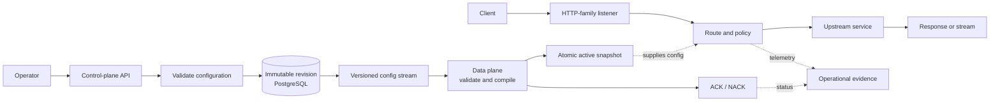

<div align="center">

# GateHouse

### Make gateway correctness visible.

A production-minded Layer 7 gateway in Go, designed around protocol correctness, safe configuration rollouts, and predictable failure behavior.

**Go:** 1.26.9 · **Contracts:** Protobuf · **CI:** [GitHub Actions](https://github.com/SShogun/GateHouse/actions/workflows/ci.yml)

</div>

> **Project state: M2 data plane plus M3 Parts 1–3 implemented and verified locally; exact-head remote CI remains.** M3 has typed configuration/Admin protobufs, PostgreSQL revision storage, a loopback-only development control plane, config streaming, instance status, and opt-in dynamic data-plane activation with last-known-good snapshots. Part 3 adds database integration and recovery tests, an executable restart scenario, and bounded 1,000-revision churn coverage. Local PostgreSQL verification used a disposable PostgreSQL 18.6 instance; CI runs the suite against PostgreSQL 16.

[What exists](#what-works-today) · [Run checks](#try-the-current-foundation) · [Target architecture](#target-architecture) · [Roadmap](#roadmap) · [Docs](#repository-map)

---

## The idea

Gateways are easy to describe as boxes and hard to get right at the edges. A client disconnect must stop upstream work. A config update must not expose a half-built state. A streamed response must remain streamed. Retries must not turn an outage into a traffic multiplier.

GateHouse is being engineered in small, reviewable increments, with executable tests for the guarantees that matter under real traffic instead of relying on architecture diagrams alone.

Its eventual boundary is deliberately split:

- **Control plane:** validates configuration, stores immutable revisions, publishes updates, and tracks data-plane status.
- **Data plane:** serves requests from a compiled local configuration snapshot; normal request handling does not depend on PostgreSQL or a synchronous control-plane call.
- **Operator console:** a future interface for configuration and operational state.

## What works today

The current implementation provides:

- separate Go command entry points for `gatehouse-control` and `gatehouse-data`;
- a static HTTP reverse proxy and compiled in-memory route/cluster runtime, with bounded server defaults and graceful shutdown;
- an opt-in dynamic mode that receives complete config snapshots over gRPC, validates and compiles candidates before atomic activation, and serves its last-known-good snapshot through control-plane outages;
- data-plane registration, ACK/NACK, heartbeat, reconnect, readiness, and connection-staleness reporting;
- deterministic route matching, endpoint selection, and optional scheduled HTTP health checks;
- SIGINT/SIGTERM handling, root cancellation, and bounded shutdown coordination;
- a `gatehouse.v1` Protobuf workspace with committed Go and TypeScript generated output;
- Buf linting, compatibility checks, and generated-code drift checks;
- an executable compatibility fixture that proves Buf rejects a removed field and accepts a compatible addition;
- separate CI jobs for contracts, static analysis, unit tests, race tests, PostgreSQL integration, and vulnerability scanning.

Without `GATEHOUSE_CONTROL_ENDPOINT`, the data-plane binary listens on `127.0.0.1:8080` and routes requests to `http://127.0.0.1:8081` by default. Set `GATEHOUSE_LISTEN_ADDR` and `GATEHOUSE_UPSTREAM_URL` to override that static demo. To run dynamically, set `GATEHOUSE_CONTROL_ENDPOINT=127.0.0.1:9090` and a stable `GATEHOUSE_INSTANCE_ID`; the process generates a fresh boot ID on startup and waits for a valid snapshot. `GET /_gatehouse/readyz` reports readiness and `GET /_gatehouse/status` reports active revision and control-stream freshness. The development control-plane command starts its Admin and config-stream services only when explicitly enabled and backed by PostgreSQL. Part 3’s database outage/recovery, process restart, and bounded churn proofs are recorded in `Gatehouse_TESTING_CI.md`; exact-head remote CI remains pending.

## Target architecture

This is the destination described by the architecture docs—not a claim that these components are already implemented.



The critical separation: the control plane owns durable configuration and publication; the data plane owns the request path and continues serving from its active snapshot when the control plane or database is unavailable.

## Try the current foundation

### Requirements

- Git
- Go 1.26.9 (the `go.mod` Go version is authoritative)
- Buf CLI 1.73.0
- `make`
- Network access on the first verification run to download pinned analysis tools and Buf generators

### Clone and verify

```bash
git clone https://github.com/SShogun/GateHouse.git
cd GateHouse
make verify
```

`make verify` runs formatting checks, `go vet`, Staticcheck, Buf lint and breaking checks, the negative compatibility fixture, generated-code drift detection, module verification, unit tests, race tests, and `govulncheck`.

### Run the static data-plane proxy

```bash
GATEHOUSE_LISTEN_ADDR=127.0.0.1:8080 \
GATEHOUSE_UPSTREAM_URL=http://127.0.0.1:8081 \
go run ./cmd/gatehouse-data
```

The default command configuration matches all requests to one cluster with one upstream endpoint. The gateway runtime also supports deterministic static route matching and cluster endpoint selection, with optional scheduled HTTP health checks when configured in memory. The proxy preserves the request method, path, end-to-end headers, and body; forwards response status, end-to-end headers, and body; strips hop-by-hop headers; propagates request cancellation; and streams response chunks without waiting for the full upstream body. In dynamic mode, the client reconnects with bounded backoff, NACKs invalid snapshots, and keeps serving the active snapshot during outages. SIGINT (`Ctrl+C`) and SIGTERM stop new requests and drain in-flight requests within the shutdown timeout. Start the development control plane with `GATEHOUSE_CONTROL_DEV_MODE=loopback` and `GATEHOUSE_DATABASE_URL` set to a PostgreSQL URL; it verifies connectivity and migrations before listening.

The development command accepts only literal loopback listener addresses, such as `127.0.0.1:8080` or `[::1]:8080`; wildcard addresses, non-loopback IPs, and hostnames are rejected. Defaults cap each listener at 128 concurrent HTTP handlers; excess requests receive HTTP 503 immediately, without a queue. Request headers have a 5-second read timeout and a 1 MiB size limit, and idle keep-alive connections close after 90 seconds. Each request-body read has a 30-second idle timeout, not a total upload deadline. The upstream must return response headers within 30 seconds after the request is written, and those headers are limited to 1 MiB. Request uploads and response bodies remain streamed, with no fixed response write timeout. Authentication and TLS remain M6 work; total request deadlines and route-level policies remain M5 work. See the [PR #5 review record](docs/Gatehouse_PR5_REVIEW.md) for dispositions and verification evidence.

## The proof bar

GateHouse treats correctness as observable behavior. The current tests cover lifecycle ordering and cancellation, HTTP forwarding and streaming, deterministic route matching and endpoint selection, health-check behavior, bounded listener resources, and contract compatibility. The contract fixture runs Buf against both a breaking and a compatible revision. Later milestones add protocol-specific behavior such as HTTP/2, Connect/gRPC status and trailer semantics, deadlines, and retry policies, with tests required before those capabilities are claimed.

No protocol is considered supported because a happy-path demo happened to work. The roadmap requires real HTTP/1.1 and HTTP/2 behavior, Connect/gRPC status and trailer semantics, and streaming/cancellation tests before those claims are made.

## Roadmap

The sequence is dependency-ordered. A later milestone does not begin just because its code exists; it begins when the preceding gate has evidence.

| Milestone | Focus |
| --- | --- |
| M0 | Repository bootstrap, Protobuf contracts, lifecycle, and CI floor |
| M1 | Static HTTP proxy and cancellation |
| M2 | Deterministic routing, clusters, load balancing, and health |
| M3 | Control plane, revisions, and atomic hot reload |
| M4 | HTTP/2, Connect, gRPC, trailers, and streaming |
| M5 | Deadlines, retries, budgets, admission, and circuit breaking |
| M6 | Authentication, rate limiting, TLS, and mTLS |
| M7 | Observability and operator UI |
| M8 | Failure campaign, load, performance, and resource hardening |
| M9 | Compatibility, release, and reproducibility |

See the [execution plan](docs/Gatehouse_PLAN.md) for each milestone's RED/GREEN gates and exact scope.

## Repository map

```text
api/gatehouse/v1/          Protobuf API namespace
cmd/gatehouse-control/     Control-plane process entry point
cmd/gatehouse-data/        Data-plane process entry point
gen/go/                    Committed Go Protobuf bindings
gen/ts/                    Committed TypeScript Protobuf bindings
internal/cluster/          Endpoint selection and health-check scheduling
internal/config/           In-memory listener and cluster configuration
internal/dataplane/        HTTP proxy, listener, and resource limits
internal/gateway/          Configuration validation and runtime assembly
internal/lifecycle/        Signal, root-context, and shutdown coordination
internal/router/           Deterministic route matching
scripts/                   Contract compatibility proof
tests/fixtures/proto-compat/ Baseline, breaking, and compatible contracts
docs/                      Architecture, decisions, roadmap, testing/CI
.github/workflows/ci.yml   Separate contract, analysis, test, race, and security jobs
Makefile                   Local verification commands
```

Start with the doc that answers your question:

| If you want to understand… | Read… |
| --- | --- |
| System boundaries and invariants | [Architecture](docs/Gatehouse_ARCHITECTURE.md) |
| Why key technical choices were made | [Decisions](docs/Gatehouse_DECISIONS.md) |
| What comes next and what must pass | [Execution plan](docs/Gatehouse_PLAN.md) |
| How behavior is tested and CI is structured | [Testing and CI](docs/Gatehouse_TESTING_CI.md) |

## Design priorities

GateHouse is being built around a request path that can keep working independently of the control plane, configuration changes that can be validated before they become active, and protocol behavior that is verified with tests. Those constraints guide the implementation as the gateway grows from its current foundation.

## Contributing

Changes should be narrow, tested, and consistent with the active milestone. Before opening a pull request, run:

```bash
make verify
```

For behavior changes, add a test that demonstrates the missing behavior before the fix. Generated bindings are committed; if a Protobuf source changes, regenerate with `buf generate` and include the resulting output.
