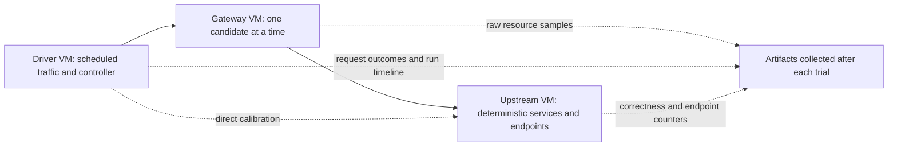

# GateHouse — Reproducible VM benchmark environment

**Date:** 2026-10-14 · **Status:** deferred under D052. The user created a Debian learning VM, exercised forwarding and resized it to 4 GiB RAM / 2 vCPU. Driver/upstream clones, benchmark calibration and campaign execution remain pending. An automatic clone helper was prepared after the user authorized assistance but was not executed because host administrator authentication was unavailable.

This extends the [competitor campaign](Gatehouse_COMPETITOR_BENCHMARK_PLAN.md). Its category formulas, workload contracts, protocol eligibility and bounded waits remain authoritative. The execution checklist stays in [the project plan](Gatehouse_PLAN.md). This document defines how we prepare machines, establish environmental validity and operate the campaign without treating a VM size as proof of isolation.

## 1. Learning approach and approval scope

Build up from the user's own machine. The user will type commands, create virtual machines in a GUI or provider console, inspect each setting, and run each service explicitly. I explain what each setting means, check outputs, and guide the next action. Do not introduce infrastructure-as-code, provisioning scripts, Ansible, cloud-init automation or one-click setup as a shortcut. If a command is used, explain its flags and effect before asking the user to run it.

The tools under consideration are:

| Responsibility | Proposed tool | Reason / boundary |
| --- | --- | --- |
| Local VM creation | Hypervisor GUI available on the user's machine; KVM/QEMU/libvirt if supported | User sees virtual CPU, memory, disk and network choices as they are made. Select only after inventory. |
| Cloud VM creation | Provider web console, only if needed and after cost is known | Manually create and inspect each resource; do not apply infrastructure-as-code. Existing free/owned machines are preferred. |
| OS setup | Installer screens and commands run by the user | Learn users, packages, network interfaces, services and resource controls rather than hiding them in bootstrap automation. |
| Candidate execution | Pinned Linux binaries, foreground first; systemd/cgroup v2 after the process lifecycle is understood | Observe the actual process and its resource use. Containers are a later deployment-specific comparison. |
| Workload and observation | Learn the direct path and counters first, then build/use the planned driver | Preserve competitor Part A semantics and scheduled-request accounting. Explain every parameter and output. |
| Workload and observation | Driver, upstream and observer from competitor Part A | Preserve scheduled-request accounting, correctness checks and raw counters. Tool selection still must pass driver conformance. |
| Analysis | Versioned analysis scripts and raw run bundles | Regenerate tables and absolute target budgets from measurements. |

Kubernetes is an optional later deployment campaign. A Kubernetes result must specify worker isolation, system reservations, resource policies and network path; it does not replace the VM baseline. No Kubernetes manifests or cluster provisioning are included in this proposal.

The user has authorized starting the hands-on learning sequence. This covers read-only inventory and teaching steps. Paid cloud resources, changes to a shared/existing server, destructive operations and public benchmark publication still require a concrete discussion before those steps. The user remains the one who creates and deletes any VM through the selected interface.

## 2. Topology and budgets



| Role | Initial allocation | Runs here | Validity requirement |
| --- | --- | --- | --- |
| Gateway | 2 vCPU; provision at least 4 GiB guest RAM; benchmark deployment cgroup capped at 2 GiB | One Caddy, Traefik or Go-RP candidate; later GateHouse data plane + control plane + PostgreSQL | Same VM/image/network path across candidate blocks; no unrelated workloads; actual CPU and memory accounting available. |
| Driver/controller | Initially 4 vCPU / 4 GiB, subject to calibration | Scheduled traffic, long-stream clients, reload/fault controller and bounded operation timeline | Healthy direct fixture does not bottleneck; CPU remains below the campaign's 70% calibration bound; no provisioning-caused dropped work. |
| Upstream | Initially 4 vCPU / 4 GiB, subject to calibration | One deterministic fixture exposing 40 logical endpoints and health/protocol checks | Direct baseline sustains required traffic; no CPU, socket or NIC bottleneck; endpoint distribution verified. |

The driver/upstream sizes are starting provisioning requests, not proven sufficient capacity. Increase them before timing if calibration fails. Do not resize a role midway through a compared block without invalidating and repeating that block.

The gateway guest needs OS/observer headroom outside its **2 GiB deployment cgroup ceiling**. The product's T08 target remains a measured whole-deployment peak of 768 MiB; neither 4 GiB guest RAM nor the 2 GiB ceiling is an achieved memory result. Report guest RAM, OS/observer footprint, deployment peak and individual process RSS separately. Gateway OS work shares the two vCPUs and is visible in host observations. Do not call two virtual CPUs two physical cores unless the hardware mapping is established.

Keep all three cloud VMs in one region and availability zone on a private network, using non-burstable fixed-size machine types. Record physical CPU model when exposed, SMT, virtual CPU mapping, kernel, image ID, machine family, NIC constraints and placement guarantees. A fixed-size cloud VM can still share its physical host: document that limit rather than claiming dedicated bare metal. Request dedicated CPU/host placement only if justified and separately cost-approved.

Use the same gateway instance for each candidate, sequentially. Cold process startup and each trial's warmup are separate phases. After teardown, verify process/cgroup/socket cleanup before starting the next candidate. Retain direct calibration between randomized run blocks to detect environmental drift.

For local KVM development, reserve disjoint host physical cores where available, avoid SMT sibling sharing across roles, and reserve host/emulator work outside gateway cores. Do not overcommit host RAM or CPUs. Archive libvirt XML and effective pinning. Three VMs on one workstation still share host, cache, memory and network resources; results carry that topology label. Publication eligibility requires evidence and a reviewed campaign profile, not merely successful VM boot.

## 3. Resource and network contract

1. Use one supported Linux distribution/image revision, cgroup v2 and systemd across roles. Resolve the exact image at implementation; archive provider ID/checksum, packages, kernel and bootstrap logs. Disable automatic upgrades during timed trials and restore their previous policy at cleanup. Do not update packages between candidate repeats.
2. On the 2-vCPU gateway guest, expose both CPUs consistently. Set Go runtime behavior explicitly where controllable and record every candidate's effective Go version/settings. Avoid an additional CFS quota in the primary two-vCPU VM panel; it can introduce throttling while duplicating the VM ceiling. Inspect inherited cgroup quotas and `cpu.stat`; a quota-constrained experiment is a separately labeled sensitivity panel. Do not impose a different CPU policy on one candidate.
3. Place the entire candidate deployment under one parent cgroup with the 2 GiB memory cap. Record `memory.current`, available `memory.peak`, `memory.events`, `cpu.stat` and process RSS. Reset peaks through a fresh per-trial cgroup where supported. Child component accounting does not replace the parent peak; do not sum peaks from different times.
4. Prevent benchmark deployment swapping through an explicitly verified cgroup/guest policy. Record effective swap configuration. OOM, process exit and CPU throttling remain outcomes; failures from genuine candidate resource exhaustion must not be erased as infrastructure noise.
5. Connect traffic directly to the candidate address and port. No external load balancer, ingress proxy, CDN, VPN or service mesh in the primary path. Use a fixed private network and archive routes, interface configuration, MTU and TCP settings. Driver-to-upstream direct calibration has its own recorded path; it is not assumed identical to the two-leg proxy path.
6. Keep metrics collection and SSH activity consistent and bounded. Sample resource state locally into bounded buffers/files; collect bundles outside the timed phase. Record observer CPU/I/O and sample loss. Calibration checks the observer's impact. Avoid polling process output through an interactive SSH session during headline trials.
7. Use fixed TLS certificates from the harness CA for TLS/H2/gRPC, without ACME/network certificate provisioning during timing. Record negotiated protocols and certificate properties; never disable TLS verification just to get a result.

The initial comparison is Linux amd64. arm64 gets an independent environment and report before arm64 performance claims.

## 4. Access, artifact integrity and fault ownership

- SSH uses an existing user-approved public key and a restricted benchmark account. Bootstrap may install required packages and create benchmark units; subsequent runs use the smallest required privileges. Inventory records ownership and only allows explicit benchmark hosts.
- Public access is limited to SSH from the operator's approved source. Proxy, metrics, fixture, PostgreSQL and administration listeners use the private network with role-specific access rules. Archive redacted firewall rules and effective listeners.
- Resolve release tags and verify published checksums/signatures where available. Record SHA-256 for every deployed binary, generated configuration and harness source. Do not download or upgrade tools during timed runs.
- Keep credentials, SSH private keys and test TLS private keys out of Git and public artifacts. If infrastructure-as-code is adopted later, its state/plans may contain sensitive values even when terminal output redacts them.
- Fault injection owns only campaign processes, ports and cgroups. Prefer stopping the owned provider process or cutting one declared dependency proxy. Any network rule change has a scoped rollback and a controller-side expiry; it must not cut SSH access or modify unrelated traffic.
- Disposable PostgreSQL is created only for GateHouse's later real dependency panel. Caddy/file-provider Traefik/Go-RP do not get an invented database dependency. The database is part of GateHouse's parent deployment cgroup for whole-stack measurements.

## 5. Small implementation slices and acceptance gates

All paths in this section are proposed artifacts, not available commands. Each slice stays bounded and updates its checklist/evidence before the next dependent slice starts.

### Part 1 — Learn the host and one Linux VM

**E0: Read your machine before choosing a hypervisor. — COMPLETE** The user ran the read-only inventory and confirmed Linux x86_64, VT-x and `/dev/kvm`. This supported selecting a local KVM learning VM; it did not establish sufficient capacity for three simultaneous benchmark roles. Exact host details remain in the conversation rather than the project file. E0 itself made no changes; the subsequent manual exercise installed Debian and demonstrated forwarding on one VM.

```sh
uname -srmo
lscpu | grep -E '^(Architecture|CPU\(s\)|Thread|Core|Socket|Model name|Virtualization):'
free -h
df -h /
systemd-detect-virt || true
test -e /dev/kvm && echo 'KVM device available' || echo 'KVM device not available'
```

These commands read OS/kernel/architecture, CPU topology, RAM, root filesystem capacity, whether this OS is already virtualized, and whether Linux KVM is exposed. They do not change the machine. On macOS/Windows, `lscpu`, `systemd-detect-virt` or `/dev/kvm` may not exist; report that and we will use the platform's built-in GUI information instead. Do not paste IP addresses, account names, keys, tokens or billing details.

Acceptance: select a local hypervisor or existing Linux host based on available RAM, distinct physical cores and network capability; write down the difference between host CPU threads and guest vCPUs. Do not install a hypervisor until this choice is understood.

**E1: Manually create one disposable Linux VM.** Using the selected GUI, user selects a supported amd64 Linux image, a small virtual disk, network mode and an initial learning allocation. First observe the installer and sign in; we inspect vCPU/RAM/disk/network from inside Linux and compare those reports with the GUI. No public listener, benchmark service or cloud exposure at this point.

Acceptance: explain each VM setting in the user's own words; connect to it; observe its assigned interface and route; shut it down and boot it cleanly. Treat this first guest as a lab machine, not a benchmark target.

**E2: Learn Linux process and resource controls.** Run a tiny foreground HTTP service, send a request from the host, inspect the process, stop it with Ctrl-C, then inspect cgroup v2 and memory/CPU reports. Only proceed to `systemd` units after foreground startup and shutdown are understood.

Acceptance: identify which process owns the listener, prove the request reaches the intended service, stop it without killing unrelated processes, and explain the difference between process RSS, cgroup memory and whole-VM memory.

**E3: Build a manual single-host forwarding demonstration.** Start a small upstream service and one reverse proxy in the foreground on the Linux VM; send valid and invalid requests; inspect logs and stop both cleanly. This teaches the path without claiming performance or competitor parity.

Acceptance: trace a request from client to proxy to upstream, verify status/body, observe an upstream failure, and clean up both processes. Record exact versions and commands in a learning note. No sustained load or headline numbers yet.

**Part 1 gate:** the Linux guest lifecycle, request path, process ownership and resource reports are understood; the VM can be rebuilt manually; all results are labeled local learning evidence. No claim is made about isolation or competitive performance.

### Part 2 — Manually create separated benchmark roles

**E4: Decide if the local host can run three roles.** Estimate simultaneous host capacity before creating more guests. Gateway target is two guest vCPUs and a 2 GiB deployment cgroup ceiling with OS headroom. Driver and upstream receive enough spare capacity to pass the direct-path calibration. If local cores/RAM cannot keep roles separate, retain the one-VM lab or price a provider's fixed-size instances before any cloud creation.

Acceptance: choose local multi-VM, existing machines, or a costed cloud pilot; document available physical cores, guest RAM, role placement, network path and shutdown/cleanup plan. Do not describe co-located roles as isolated.

**E5: Manually create the driver and upstream Linux VMs.** Use the same OS release where practical, private networking, and explicit names/addresses. Keep the candidate gateway role separate. Write down each GUI/console setting and verify from each guest. Test direct driver-to-upstream connectivity before installing proxy software.

- [ ] Verify each machine's CPU, RAM, kernel, network route and time synchronization.
- [ ] Verify the driver can reach upstream directly and gateway-to-upstream connectivity is private and consistent.
- [ ] Demonstrate that driver and upstream have spare CPU/RAM under calibration; resize all candidates' environment together if they do not.

**E6: Manually install and compare pinned reference candidates.** Follow the competitor plan's exact candidate scopes, download from official release sources, verify checksums, inspect command-line options and start one candidate at a time. Generate/inspect effective configs before any timed run. Record the source, version, digest and every setting.

- [ ] Pass route, health probe, forwarding, TLS/HTTP2/gRPC and stream conformance where applicable.
- [ ] Measure direct fixture headroom and driver schedule accuracy; keep raw loss counts.
- [ ] Distinguish configuration/setup learning from measured performance; no full campaign begins if conformance/calibration fails.

**Part 2 gate:** three roles and their network paths are understood and verified; all candidates pass the applicable semantic checks; driver/upstream/observer do not bottleneck. The small pilot remains validation, not a competitor leaderboard.

### Part 3 — Run, analyze and clean up by hand

**E7: Execute the reviewed run matrix.** Reuse competitor Part B. Before each run, write down candidate, protocol, track, telemetry mode, repeat, load, deadlines and eligibility. User starts/stops the processes and confirms each stage before proceeding.

- [ ] Freeze manifest and configs, randomize five run blocks, measure capacity brackets/matched loads and complete stream/reload/fault/telemetry/whole-stack/stability panels.
- [ ] Every T01–T09 row ends measured, FAIL, N/A, UNAVAILABLE or explicitly incomplete. Do not declare the full campaign complete after a smaller pilot.
- [ ] Keep invalid runs and their predefined exclusion reasons; do not selectively rerun a losing candidate until it looks better.

Dependency: Part 2 gate and separately approved matrix/run budget. Size: multiple bounded run batches; long soak is a planned batch, not an interactive blocking tool call.

**E8: Analyze the evidence.** Reuse competitor Part C steps 9–10. Keep raw outputs, show each run, calculate the target budgets, then verify the report cells against source data.

- [ ] Raw bundles reproduce actual-unit metrics, per-run values, paired uncertainty and a capability/fault-kind panel.
- [ ] Derive absolute GateHouse RSS/capacity/latency/goodput targets with provenance. Independent product budgets remain explicit hypotheses; do not fill GateHouse measured cells with derived targets.
- [ ] Perform one bounded independent review when authorized/available; record every finding separately and resolve or disclose it. Publication waits for user authorization.

Dependency: E7 complete for the claimed scope. Size: medium reporting/analysis slices.

**E9: Collect and clean up.** User checks each owned process, rule, VM, disk, address and artifact manually. No cleanup script or broad delete command.

- [ ] Collect complete checksummed raw bundles, redact secrets and verify local readability before destroying transient machines.
- [ ] Stop owned processes, remove expiring fault rules and restore managed policies on retained machines. No cleanup by broad process names or deleting an entire user directory.
- [ ] For approved disposable cloud resources, review the destruction scope, destroy only campaign-owned objects and confirm disks/IPs/snapshots are gone or explicitly retained with costs.

Dependency: collection after every batch; final teardown after E8 or a blocked campaign. Resource deletion requires authorization appropriate to the concrete scope.

**Part 3 gate:** the claimed scope has evidence, report reproduces, unresolved findings are disclosed, cleanup is verified and artifact retention is recorded. GateHouse's own comparable measurements still depend on its applicable P0/P1 capabilities and Q_all rerun rules.

## 6. Time and cost controls

No provider, paid resource or monetary amount is selected by this plan. Before cloud apply, present:

`estimated cost = sum(role hourly rate × provisioned hours) + disks + network/egress + retained artifacts/IPs + applicable taxes`

If local capacity is insufficient, price the chosen provider with its current official calculator and billing rules. Reuse existing machines where possible. For an initial controlled pilot, price a four-hour reservation window even though the run itself is capped at two hours; include boot/setup/collection/cleanup. This is a costing allowance, not a promise that implementation is completed in four hours. Full campaign cost is computed from the actual enumerated matrix and measured pilot runtimes, including five repetitions, warmups, refinement, churn, soaks and fault recovery. A large matrix may require several approved batches.

Every approved batch specifies maximum elapsed time, maximum paid machine-hours and a spending ceiling. A budget alert alone does not stop billing: the campaign needs an independent expiry/cleanup mechanism where supported, plus an operator checklist to confirm destruction. On controller loss, local runners stop at their deadlines; cloud instances can still incur cost until cleanup completes. Describe that residual risk and record cleanup confirmation.

## 7. Evidence and invalidation rules

Each run bundle records campaign ID, profile, source SHA/dirty patch hash, binary/config digests, exact tool/runtime versions, role manifests, timestamps, randomized order, resource samples, scheduled-request outcomes, upstream validation, stream/reload timelines and cleanup results. Preserve machine-readable raw files and derive graphics only from the reviewed dataset.

Predeclare infrastructure invalidation conditions before the matrix: artifact/config drift, incorrect endpoint semantics, observer loss preventing required measurements, driver provisioning failure, direct-fixture bottleneck and material host/network drift. Define concrete drift bounds from calibration before headline runs; stop and report the gate unresolved if no stable bound can be established. Do not invent exclusions after seeing candidate rankings. CPU steal and NIC drops are diagnostic evidence; a valid but slow candidate remains a measured outcome.

The report names all deviations from this plan. Single-host local measurements are useful engineering evidence but cannot be presented as measurements from the separate-role controlled topology. A changed VM type, resource policy or protocol creates a new campaign profile. Successful automation does not certify hardware isolation or benchmark validity.

## 8. User choices needed before provisioning

These are questions for later stages; none is needed for the first no-cost host inventory:

1. **Starting environment:** existing Linux VMs, local KVM/libvirt, or a chosen cloud provider/account.
2. **Available hardware:** local CPU/core layout and RAM, or selected region and available fixed-size VM types.
3. **Cost ceiling:** currency, maximum spend and maximum provisioned duration for the first controlled pilot.
4. **Access and ownership:** approved SSH public key/source network; who creates and destroys machines; any hosts that must remain untouched.
5. **Learning pace:** one task at a time; do not skip ahead until the user can explain the previous step and its output.

## 9. Sources and decision status

- [libvirt domain CPU tuning](https://libvirt.org/formatdomain.html) — vCPU/emulator pinning controls; pinning still requires host placement evidence.
- [Linux cgroup v2](https://www.kernel.org/doc/html/latest/admin-guide/cgroup-v2.html) — memory and CPU accounting/control semantics.
- [Kubernetes resource management](https://kubernetes.io/docs/concepts/configuration/manage-resources-containers/) — requests/limits, CPU throttling and node allocatable resources.
- [Compute Engine CPU platforms](https://docs.cloud.google.com/compute/docs/cpu-platforms) — virtual CPU/physical core mapping varies by machine series; this is an example, not a selected provider.

D032 and D046–D051 remain binding except for scheduling and provisioning scope superseded or paused by D052. E0 inventory and the single-VM learning exercise have occurred; the final three-role topology, CPU placement, resource policies, calibration and benchmark campaign remain pending. The one Debian lab VM is not evidence of a completed benchmark environment.
